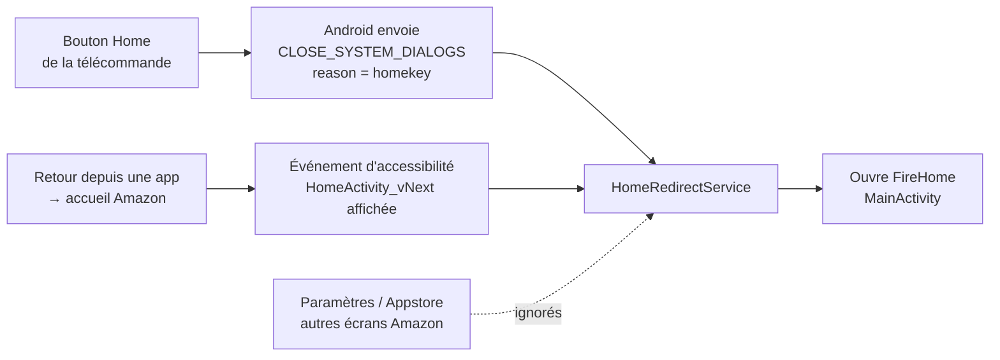

# 🔥 FireHome

**Un écran d'accueil personnalisé pour Fire TV Stick, sans root.**

FireHome remplace l'accueil d'Amazon (pubs, contenus sponsorisés, menus chargés) par un tableau de bord simple et lisible, pensé pour un usage familial : heure, météo, programme TV du soir, raccourcis et toutes les apps en grandes tuiles, navigable entièrement à la télécommande.

Développé en **Kotlin** avec **Jetpack Compose**, testé sur un Fire TV Stick 4K (2ᵉ génération, Fire OS 8 / Android 11).

<!-- Capture : powershell -ExecutionPolicy Bypass -File scripts\captures.ps1 accueil, puis :  -->

---

## ✨ Fonctionnalités

| | |
|---|---|
| 🕒 **En-tête** | Heure, date, salutation selon le moment de la journée, météo actuelle + 3 jours (Open-Meteo) |
| 📺 **Ce soir à la télé** | Programme de 21 h sur TF1, France 2, France 3, Canal+, France 5, M6, Arte (flux XMLTV), un clic ouvre l'app de la chaîne |
| ⏯️ **Reprendre** | Les dernières apps utilisées, détectées automatiquement |
| ⚡ **Raccourcis** | Paramètres, Wi-Fi, manettes, navigateur, Appstore, accueil Amazon |
| 🧩 **Apps** | Toutes les apps installées avec leurs bannières ; menu ☰ pour **déplacer**, **masquer** ou voir les infos d'une app |
| 👤 **Profils** | Deux profils indépendants (réglages, ordre, apps masquées, récents) |
| 🌙 **Écran de veille** | Grande horloge + météo après quelques minutes d'inactivité, avec léger déplacement anti-marquage |
| 🛠️ **Réglages sur la TV** | Ville de la météo, thème du fond animé, nombre de colonnes, sections affichées, délai de veille |
| 🏠 **Bouton Home** | Le bouton Accueil de la télécommande ramène sur FireHome, qui s'ouvre aussi au démarrage |

Autour de l'app, des **scripts PowerShell** automatisent l'installation, le nettoyage du stick (« debloat »), l'installation d'outils complémentaires et la **sauvegarde / restauration** complète de la configuration.

---

## 🧠 Comment ça marche (sans root)

Sur les versions récentes de Fire OS, Amazon empêche de choisir un autre écran d'accueil par défaut, et le Fire TV Stick 4K 2ᵉ gen ne peut pas être rooté. FireHome contourne la limite avec un **service d'accessibilité** :



- Le service écoute le message système envoyé à chaque appui sur Home et ouvre FireHome.
- Il surveille aussi les changements de fenêtre : quand **l'écran d'accueil Amazon** (`HomeActivity_vNext`) apparaît après la sortie d'une app, il redirige vers FireHome.
- Les autres écrans de l'interface Amazon (paramètres `MainSettingsActivity`, Appstore…) sont volontairement laissés passer. Leurs noms ont été identifiés en analysant `dumpsys window` et `logcat` sur le stick.

Le service est activé par ADB (`settings put secure enabled_accessibility_services …`), ce qui évite à l'utilisateur de passer par les menus d'accessibilité.

---

## 🏗️ Architecture

```
app/src/main/java/com/axel/homeboard/
├── MainActivity.kt          Activité principale, détection d'inactivité, raccourcis (intents Fire OS)
├── HomeScreen.kt            Toute l'interface Compose : grille, tuiles, menus, réglages, écran de veille, fond animé
├── HomeRedirectService.kt   Service d'accessibilité qui remplace l'accueil Amazon
├── AppRepo.kt               Liste des apps (PackageManager, bannières Leanback), avec cache
├── WeatherRepo.kt           Météo Open-Meteo (HTTP + JSON)
├── TvGuide.kt               Programme TV : téléchargement XMLTV gzip, parsing en flux (XmlPullParser), cache JSON journalier
├── Profiles.kt              Gestion des 2 profils (préférences préfixées par profil)
├── Prefs.kt                 Ordre, apps masquées, apps récentes
├── HomeSettings.kt          Réglages (ville, thème, colonnes, veille…)
└── BackupReceiver.kt        Export / import de la config via ADB (protégé par la permission DUMP)
```

**Points techniques notables**

- **Navigation à la télécommande** : gestion du focus Compose (D-pad), effet d'agrandissement sur l'élément sélectionné, menus modaux qui gardent le focus, mode « déplacement » des tuiles au clavier.
- **Performance sur un petit processeur** : build release optimisé par R8, fond animé limité à 15 images/s, liste d'apps mise en cache et recalculée uniquement quand une app est installée ou mise à jour.
- **Fichier XMLTV volumineux** (plusieurs dizaines de Mo) : lecture en flux depuis le gzip, sans tout charger en mémoire, arrêt dès que toutes les chaînes sont trouvées, puis mise en cache pour la journée.
- **Android 11 – visibilité des paquets** : déclarations `<queries>` pour pouvoir lister et lancer les autres apps.
- **Sécurité** : le récepteur de sauvegarde n'est déclenchable que par le shell ADB (permission `DUMP`, inaccessible aux apps tierces).

---

## 🚀 Installation

**Prérequis** : Windows, [Android Studio](https://developer.android.com/studio) (pour le SDK et Java), les [platform-tools](https://developer.android.com/tools/releases/platform-tools) (`winget install Google.PlatformTools`).

1. Sur le Fire TV : *Paramètres > Mon Fire TV > À propos*, cliquer 7 fois sur le nom de l'appareil, puis activer **Débogage ADB** dans *Options pour les développeurs*.
2. Noter l'IP du stick (*À propos > Réseau*) et, de préférence, la fixer dans la box.
3. Ajouter sa config personnelle à la fin de `local.properties` (fichier local, jamais publié) :
   ```properties
   firehome.firetv=192.168.1.XX:5555
   firehome.profiles=Prénom1,Prénom2
   firehome.city=Paris
   ```
4. Lancer **`installer.bat`** : compilation, installation, activation du bouton Home et lancement de FireHome.

---

## 🧰 Scripts

| Script | Rôle |
|---|---|
| `installer.bat` | Compile (release), installe FireHome et active la redirection du bouton Home |
| `scripts/debloat.ps1` | Retire ou désactive les apps Amazon inutiles et la télémétrie (réversible) |
| `scripts/restore.ps1` | Annule le debloat |
| `scripts/installer_extras.ps1` | Installe SmartTube (YouTube sans pub) depuis GitHub et réinstalle le navigateur |
| `scripts/sauvegarde.ps1` | Sauvegarde la config FireHome, le DNS privé, la liste des apps et les APK installés à la main |
| `scripts/restaurer.ps1` | Restaure tout sur un stick réinitialisé ou neuf |
| `scripts/captures.ps1` | Capture d'écran du Fire TV dans `docs/` |

Lancement : `powershell -ExecutionPolicy Bypass -File scripts\nom_du_script.ps1`

Bonus : un DNS bloqueur (AdGuard DNS en DNS privé) se configure en deux commandes :
```powershell
adb shell settings put global private_dns_mode hostname
adb shell settings put global private_dns_specifier dns.adguard-dns.com
```

---

## ⚠️ Limites

- Au retour sur l'accueil, l'interface Amazon peut apparaître une fraction de seconde avant FireHome.
- Les pubs intégrées aux flux vidéo (Prime Video, chaînes TV) ne peuvent pas être bloquées côté appareil.
- Les noms d'écrans Amazon (`HomeActivity_vNext`…) peuvent changer avec une mise à jour de Fire OS ; il suffit alors d'adapter `HomeRedirectService.kt`.
- Personnalisation : prénoms des profils, ville par défaut et IP du stick dans `local.properties` ; liste des villes dans `HomeSettings.kt`, chaînes TV dans `TvGuide.kt`.

---

## 📚 Crédits

- Météo : [Open-Meteo](https://open-meteo.com/) (API libre, sans clé)
- Programme TV : flux XMLTV de [xmltvfr.fr](https://xmltvfr.fr/) (projet [XML-TV-Fr](https://github.com/racacax/XML-TV-Fr))
- YouTube sans pub : [SmartTube](https://github.com/yuliskov/SmartTube)

## 📄 Licence

[MIT](LICENSE) © 2026 Axel B.
